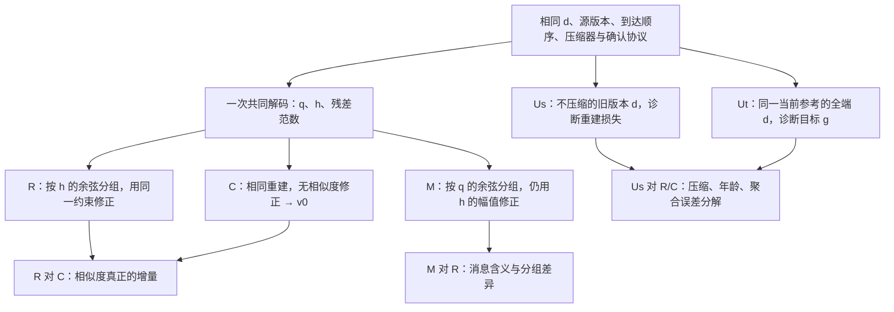

# B-Q00：方向 B 的纸面资格设计与必要条件审查

> 后续入口（2026-10-20）：下文保留 B-Q00 当时的结论与原 §9 草案，原样草案未执行。根据作者新的条件授权，§6.5、§10 所需修订依据已写入 [B 修订资格](DIRECTION_B_QUALIFICATION_REVISION_v1.md)；新任务 B-R01 已完成有限非训练验证，见 [结果与审查](projects/direction_b/R01_RESULT.md)。当前状态以 [STATE](projects/direction_b/STATE.md) 为准，训练仍未开放。[文件]

日期：2026-10-20。输入分支：`codex/direction-a-prime`；输入提交：`1a016cd06a531cf5bac13e91c060ed6bab203327`。任务依据：[B-Q00 交接单](DIRECTION_B_QUALIFICATION_HANDOFF_v1.md)。角色、交付和止损规则只采用 [通用工作流](RESEARCH_WORKFLOW_v1.md)，没有使用 A′ 的旧提示词。[文件]

**本轮建议：收窄，停留在纸面资格阶段。状态差分重建可以自洽，但其核心递推已有直接近邻；目前的“缓存校准后再加相似组修正”缺少足以投入程序验证的必要性依据。尤其在缓存已经准确时，该修正仍可能增加方向误差。这里停止的是把现有模块组合直接推进为新算法实验的计划，不是否定一切异步压缩或相似度聚合研究。**[推断，依据见 §6–7]

本文件是 B-Q00 的纸面交付和技术建议；独立 Reviewer 的回签不在本轮记录中。后续审查应检验这些论证，而不是把文档完成视为资格通过。[文件：本轮交付范围]；[推断]

**本轮没有运行实验、调用模型、生成事件轨迹或开放训练。A′ 保持关闭，E03 不开放；旧结果与数字未修改。** §9 留下的是完整的后续非训练任务草案，状态为 **DRAFT / NOT AUTHORIZED / 当前不建议原样派发**。它不构成运行许可，也不自动启动方向 C。[文件：本次作者指令、B-Q00 交接单]；[推断：本轮建议]

导师不指导选题、机制或中途技术决策；论文完成后才判断是否够参加盲审。内部资格以 `master's thesis/` 的具体实例为参照，本轮使用已有 [硕士论文基准](MASTERS_THESIS_BENCHMARK_v1.md)，不新增等待导师认可的关口。[文件：通用工作流 §1、硕士论文基准 §1]

## 1. 本轮回答什么，以及证据边界

本轮回答：**排除通用压缩与恢复机制后，B 是否还保有一个目标明确、可以被最强直接对照否定、值得最小程序验证的聚合命题？** “程序能跑”“缓存能恢复”“比直接拿差分消息分组好”分别只能回答局部问题。[文件：B-Q00 交接单]；[推断]

|栏位|本轮状态|证据及限制|
|---|---|---|
|科学主张|**局部支持；部分否定；效用证据不足**|恒等式与协议对象可以定义；“分组必然补足缓存校准”被 §6 的反例否定；特定训练任务上的精度、最差端或总通信收益未检验。[推断]|
|测量有效性|**纸面演算可核对；程序测量待补**|下文给精确向量、分母和计算过程。没有新的实验测量，不能标为实验有效或实验失败。[推断]|
|工程状态|**纸面设计完成；B 实现未开始**|现有异步接口只作静态核对，不能继承运行或恢复验收；实现缺口见 §8。[文件]；[推断]|
|资源状态|**部分未知**|本轮仅文献、代码和文档阅读/编辑；未来程序秒数、完整峰值内存和磁盘预算均未实测。没有以“零训练”冒充“零成本”。[推断]|

来源约定：`[文件]` 指现有仓库文档或本轮静态读到的代码；`[提交]` 标身份锚点；`[定向查阅]` 只用于本轮实际读到的原文页；`[推断]` 包括本设计、手算例子和提出的资格标准。已有文档中的原文摘要如未重读，仍标 `[文件]`。页码均为 **PDF 文件页码**，不是论文正文页码。[推断：记录约定]

### 1.1 定向阅读台账

|材料|本轮范围与用途|证据边界|
|---|---|---|
|`RESEARCH_INNOVATIONS_v1.md`，方向 B §2–6；`DIRECTION_SELECTION_v1.md`，相关理论/近邻/代码定位|核对原先承诺、无分组消融、目标权重和工程基础。|原文件是候选设计，不是有效性证据。[文件]|
|`RESEARCH_WORKFLOW_v1.md`、`RESEARCH_REUSE_CATALOG_v1.md`、`MASTERS_THESIS_BENCHMARK_v1.md`、B-Q00 交接单|现行角色、复用、资格与资源边界。|没有重扫 A/A′ 的提交、裁决或封存结果。[文件]|
|`refs/R06_Wang2024_CA2FL.pdf`|PDF 5–6 页：算法 2、式 (4.1)、与 SAGA 的区别、状态延迟条件；视觉核对第 6 页。|原文已有“缓存均值＋返回更新与旧缓存之差”的校准；不能直接继承其定理到本文压缩/分组协议。[定向查阅：该文件，PDF 5–6 页]|
|`refs/R07_Sattler_STC.pdf`|PDF 6–7 页：收缩压缩器、客户端残差、下行压缩与部分参与的补同步；视觉核对第 7 页。|仅核对所需机制。本轮没有重读其通信实验；“目标精度字节表限 IID”沿用基座与创新点 v1。[定向查阅：该文件，PDF 6–7 页]；[文件]|
|`master's thesis/面对非独立同分布的联邦学习聚合优化研究_朱桁颍.pdf`|视觉读取 PDF 41–43 页：余弦关系、聚合目标、SNG 后的方向估计和 FedBEF 主流程。|原方法包含更新标准化、方向估计及求权重；本文简化的“组均值减端均值”不能冒充完整 FedBEF。[定向查阅：该文件，PDF 41–43 页]|
|Richtárik、Sokolov、Fatkhullin，*EF21: A New, Simpler, Theoretically Better, and Practically Faster Error Feedback*，NeurIPS 2021|新增的唯一状态跟踪近邻；定向核对官方论文 PDF 7–8 页的 Markov 递推及算法 2。|递推已经包含“旧估计＋压缩的新向量与旧估计之差”。这是排除 B1 独立新颖性的直接依据；本轮未评审其全部扩展或做完备查新。[定向查阅：`231141b34c82aa95e48810a9d1b33a79-Paper.pdf`，PDF 7–8 页]；[官方原文](https://papers.nips.cc/paper_files/paper/2021/file/231141b34c82aa95e48810a9d1b33a79-Paper.pdf)|

未扫描 `paper/`、`master's thesis/`、`refs/` 全目录。上述 PDF 阅读只产生临时页面用于核对，没有改动文献文件。[文件：本轮读取范围]

## 2. 先固定对象：重建什么，聚合又要接近什么

### 2.1 符号、正负号和版本

取同构参数空间 \(\mathbb R^D\)，固定客户端总体 \(i=1,\ldots,N\)。首版采用等客户端权重，目标为 \(F(w)=N^{-1}\sum_i F_i(w)\)；不混用按样本量加权的目标。若以后换目标，必须重写基础校准及误差参考。[推断]

客户端第 \(k\) 次有效上传从服务器版本 \(s_i^k\) 的参数 \(w_{s_i^k}\) 开始，使用相同本地学习率 \(\eta_l>0\)、相同本地步数 \(K\)，定义

\[
d_i^k=\frac{w_{s_i^k}-w_{i,\mathrm{end}}^k}{\eta_l K},
\qquad w_{t+1}=w_t-\eta_s v_t .
\tag{1}
\]

这里 \(d_i^k\) 是**下降号约定下的本地伪梯度**，不是参数本身，也不是一般情况下的 \(\nabla F_i(w_t)\)。仅在相应单步、确定性梯度条件下两者相等。实际模型差值接口若上传 `local-global`，须先取负并除以 \(\eta_l K\)，不能直接接入式 (1)。[文件：创新点 v1 B1；`easyFL/resources/algorithm/ca2fl.py` 的 `Client.reply`]；[推断]

应同时记录三个不互换的序号：[推断]

- \(t\)：服务器聚合后模型版本；
- \(s_i^k\)：本次本地计算的起始模型版本，定义更新年龄 \(t-s_i^k\)；
- \(k\)：该端已提交的传输状态序号，决定差分解码参照，与模型年龄不同。

令 \(d_i(w;\xi)\) 表示以 \(w\) 为起点、固定本地计算约定和随机输入 \(\xi\) 得到的伪梯度。在纸面和未来非训练夹具中，先比较同一参考点、同一计算约定下的

\[
g_t^{d}=\frac1N\sum_i d_i(w_t;\xi_i).
\tag{2}
\]

其用途是隔离压缩、缺席缓存和聚合误差。正式优化分析还需处理 \(g_t^{d}-\nabla F(w_t)\) 的本地漂移及随机误差；不能将式 (2) 的拟合改善直接称为准确率改善。未来夹具只给解析向量序列，不求模型梯度。[推断]

### 2.2 双方共同状态与残差

初始化 \(h_i^0=d_i^0=e_i^0=0\)，其中 \(d_i^0\) 是递推用的虚拟初值，不代表已计算初始梯度。共同的已确认缓存为 \(h_i^{k-1}\)。定义

\[
q_i^k=Q(d_i^k-h_i^{k-1}),\qquad
h_i^k=h_i^{k-1}+q_i^k,\qquad
e_i^k=d_i^k-h_i^k .
\tag{3}
\]

\(Q\) 包含编码再解码的实际映射，\(q_i^k\) 指解码后的向量。客户端必须按同样的数值格式、索引和加法约定计算候选 \(h_i^k\)，并对这个候选计算残差范数；不能用编码前的理想向量计算元数据。[推断]

以下恒等式和条件界按实数运算书写。未来浮点实现中的缓存加法舍入误差须按预定容差检查或单列；双方同序号得到相同位模式，也不等于对真实 \(d_i^k\) 的误差为零。[推断]

服务器只需保存 \(h_i^k\)、源版本及必要元数据；完整 \(e_i^k\) 可留客户端，服务器获得其范数。身份有效时，

\[
d_i^k-h_i^{k-1}=(d_i^k-d_i^{k-1})+e_i^{k-1}
=\delta_i^k+e_i^{k-1}.
\tag{4}
\]

这是**更新序列的差分跟踪恒等式**。它不证明无偏、当前版本准确、相似度正确或算法新颖。普通绝对更新误差反馈 \(m^k=Q(d^k+r^{k-1})\) 的 \(m^k\) 则是带补偿的消息；不能将 \(m^k\)、\(q^k\)、\(h^k\) 互换命名。[定向查阅：R07_Sattler_STC.pdf，PDF 7 页，式 (15)–(19)]；[推断]

## 3. 最小协议：确认、缓冲与恢复的状态语义

本节固定首版的有限语义：单服务器、每端最多一个未确认消息、每缓冲至多一次该端有效贡献；不承担任意永久状态丢失的透明恢复。事务持久化是实现要求，不是本轮已经验收的能力。[推断]

### 3.1 何时提交状态

|时点|客户端|服务器与缓冲|
|---|---|---|
|准备发送|保留已确认的 `(epoch, k-1, h_old)`；持久保存待发包及候选 `h_new`，然后才发送。|缓存保持原值。[推断]|
|合法接收|尚未收到 ACK，不能把候选改称双方已确认，也不能再发下一状态更新。|核验 epoch、端号、基准序号、包身份；原子提交 `h_new`、序号、源版本、去重记录及唯一缓冲凭据，再发送 ACK。[推断]|
|收到 ACK|持久提交 `h_new,k`，清除待发记录。|该端在本缓冲关闭前仍不发起第二个计算任务；ACK 不等于调度释放。[推断]|
|缓冲关闭|待下一任务；无需改动缓存以适应聚合权重。|原子提交本次聚合编号、已消费凭据和下一模型版本，随后释放缓冲客户端。[推断]|

“双方状态一致”准确地说是：**双方对同一已确认序号解码出的状态一致**。ACK 在途时允许服务器领先一步，客户端通过持久的待发记录恢复，不能要求网络两端每一时刻都同时提交。[推断]

缓冲打开时锁定逻辑快照 \(h_i^-\)。消息的传输状态 \(h_i^+\) 可逐条提交，但基础均值仍使用打开时的快照；不能边接收边改快照，最后又重复加一次新旧差。[推断]

对大小为 \(B\) 的不同客户端集合 \(\mathcal B_t\)，定义

\[
v_t^0=\frac1N\sum_i h_i^-+
\frac1B\sum_{i\in\mathcal B_t}(h_i^+-h_i^-).
\tag{5}
\]

这借用 CA2FL 的校准结构，但符号、尺度、差分压缩和唯一端缓冲是本设计的明确约定。原文式 (4.1) 不能自动证明式 (5) 在相关到达、压缩或本地漂移下无偏。[定向查阅：R06_Wang2024_CA2FL.pdf，PDF 5–6 页]；[推断]

维护快照不一定复制全部 \(N\) 个向量：可以保留缓冲开始时的全端缓存和，以及当前缓冲端的旧值。实现如何减少复制属于工程选择，不改变式 (5)。未关闭的缓冲、冻结和、各旧值、ACK/消费身份都必须进入恢复对象。[推断]

### 3.2 重复、过时与中断的处理

|情况|规定动作|不能据此声称什么|
|---|---|---|
|同一包重发，序号与内容一致|返回已有 ACK；不再次加 \(q\)，不再增加缓冲人数。|这只是幂等接收。[推断]|
|同一序号但内容不同，或基准序号不匹配|不应用；按服务器持久状态对账，不猜测新参照。|不能通过“再加一次试试”恢复。[推断]|
|传输序号正确，但起始模型版本较旧|接受其状态跟踪更新并记录年龄；过龄时可禁用相似度，基础项仍按固定协议处理。|“过龄不分组”没有让基础项变成当前梯度。[推断]|
|服务器提交前中断|客户端重发持久待发包；从共同旧状态正常接收一次。|不需要重新计算 \(d\)。[推断]|
|服务器已提交，ACK 发送前/途中中断|服务器读回去重记录，重发 ACK；客户端保留待发包并对账。|不得第二次应用差分。[推断]|
|客户端收到 ACK、落盘前中断|仍可用旧持久状态与待发包重发，对账后提交候选。|不得凭“可能收到过 ACK”丢掉待发记录。[推断]|
|ACK 已落盘后中断|恢复已确认状态；缓冲是否消费由服务器记录决定。|不能重新插入已消费贡献。[推断]|
|聚合已算出、消费事务尚未提交时中断|从冻结快照和未消费凭据重建一次；只有已提交消费事务才推动模型版本。|不能因为重复启动而重复更新模型。[推断]|
|服务器丢失已经 ACK 的持久提交，或客户端连已确认基准/待发包都丢失|超出上述恢复假设；停止该恢复路径，或另开记录完整重建成本和语义的新 epoch。|不能声称任意回滚后“精确继续”。[推断]|

简单全量同步只能建立**往后的共同基准**，不能自动证明丢失期间没有遗漏/重复聚合。epoch 改变、全量状态、模型下发及确认均计入通信。若要覆盖跨机器永久故障，必须另评科学价值和成本，不能让资格任务演变为分布式存储项目。[推断]

## 4. 可逐项手算的对象与协议例子

以下均为自造数学夹具，没有调用代码计算。二维 `Top1` 保留绝对值最大的坐标，其余置零；相等时取较小坐标编号。用小维度是为了核对含义，不用其包大小推断模型压缩效率。[推断]

### 4.1 一条正常短轨迹

|有效序号|\(d^k\)|\(h^{k-1}\)|\(q^k\)|\(h^k\)|\(e^k\)|
|---|---|---|---|---|---|
|1|\((3,1)\)|\((0,0)\)|\((3,0)\)|\((3,0)\)|\((0,1)\)|
|2|\((3,2)\)|\((3,0)\)|\((0,2)\)|\((3,2)\)|\((0,0)\)|
|3|\((2,2)\)|\((3,2)\)|\((-1,0)\)|\((2,2)\)|\((0,0)\)|

逐行满足式 (3)；第 2 行的压缩输入为 \(\delta^2+e^1=(0,1)+(0,1)=(0,2)\)。若第 2 个包因 ACK 丢失被重发，正确结果仍为 \((3,2)\)；错误地加两次会得到 \((3,4)\)。这验证的是协议必须防止重复应用，不是精度实验。[推断]

### 4.2 退化例子及其能证明的范围

|夹具|手算|支持的结论|
|---|---|---|
|当前方向相同，但旧残差不同|普通绝对更新 EF：两端当前 \(d=(1,0)\)，旧残差分别为 \((0,2)\)、\((0,-2)\)。Top1 消息为 \((0,2)\)、\((0,-2)\)，消息余弦为 \(-1\)，真实当前方向余弦为 \(1\)。这些残差也可由前一轮压缩 \((3,\pm2)\) 得到。|含残差的绝对消息可能把相同方向判为相反；没有证明状态跟踪总能消除当前模型年龄误差。[推断]|
|同一重建状态，不同差分消息|两端当前 \(d=(1,1)\)，旧缓存为 \((1,0)\)、\((0,1)\)。Top1 差分为 \((0,1)\)、\((1,0)\)，重建后都为 \((1,1)\)。|消息余弦 \(0\)，重建余弦 \(1\)；差分方向不是当前状态方向。[推断]|
|同一旧状态，不同真实增量却得到同一重建状态|两端旧缓存均为零，当前 \(d_1=(1,1)\)、\(d_2=(1,-1)\)。Top1 都输出 \((1,0)\)，新缓存也相同；残差分别为 \((0,1)\)、\((0,-1)\)。|重建余弦 \(1\)，真实余弦 \(0\)；两个残差范数都为 \(1\)，上传范数无法恢复遗漏坐标的符号。[推断]|
|零差分、非零状态|旧缓存与当前 \(d\) 都为 \((1,1)\)，故 \(q=0,h^+=(1,1)\)。|不能把“消息余弦未定义”记作“当前更新没有方向”；不发送数值载荷也仍需版本/确认信息。[推断]|
|零状态与近零状态|若 \(h^+=0\)，其余弦不定义；若 \(d=0\) 而 \(h^+\ne0\)，残差仍可能非零。|先做范数门控，禁用相似度；不能强设余弦为 \(0\) 或 \(1\) 来掩盖缺测。[推断]|
|相同旧状态与年龄，不同当前方向|旧的 \(d,h\) 均为 \((1,0)\)，年龄同为一个版本；两个允许的更新序列在当前点可以分别为 \((1,0)\)、\((-1,0)\)。|没有变化界时，年龄数字本身不提供当前余弦误差界。[推断]|
|过时包、重复包与确认中断|沿用 §4.1 第 2 行。旧模型版本不改变基准序号；重复包应用次数仍为一次；ACK 前后按 §3.2 对账。|模型新鲜度、传输身份与聚合消费必须分开。纸面语义不等于已通过恢复测试。[推断]|

## 5. 误差、相似度与约束：哪些能推，哪些推不出来

### 5.1 跟踪界不是无偏性，也不是自动一致性

假设实际压缩映射满足条件收缩界：对当前输入及历史条件，

\[
\mathbb E[\|Q(x)-x\|^2\mid\mathcal H]\le(1-\omega)\|x\|^2,
\qquad 0<\omega\le1.
\tag{6}
\]

Top-\(k\) 的实数理想算子有 \(\omega=k/D\)；额外量化、数值格式和选择规则必须重新确认，不能把保留比例直接当任意 STC 实现的同一个常数。STC 原文给出了自己的收缩表述，本文不搬用它的完整联邦收敛结论。[定向查阅：R07_Sattler_STC.pdf，PDF 6 页]；[推断]

由式 (3)–(4) 与 Young 不等式，对任意 \(\beta>0\)，

\[
\mathbb E\|e^k\|^2\le
(1-\omega)(1+\beta)\mathbb E\|e^{k-1}\|^2+
(1-\omega)(1+\beta^{-1})\mathbb E\|\delta^k\|^2.
\tag{7}
\]

若 \(\omega<1\)，取 \(a=(1-\omega)(1+\beta)<1\)，记
\(c=(1-\omega)(1+\beta^{-1})\)，迭代可得

\[
\mathbb E\|e^k\|^2\le a^k\mathbb E\|e^0\|^2+
c\sum_{\ell=1}^{k}a^{k-\ell}\mathbb E\|\delta^\ell\|^2.
\tag{8}
\]

若变化能量始终不超过 \(V\)，只得到 \(cV/(1-a)\) 型误差地板；要推出误差趋零还需变化项趋零等条件。若 \(\omega=1\)，理想收缩条件直接给出零压缩误差，不必套含 \(\beta\) 的选择。长时间缺席和分布/参考点变化会放大 \(\delta\)，不能承诺“旧残差自然消失”。[推断]

同样，绝对更新 EF 的 \(m_k=d_k+r_{k-1}-r_k\) 经变化的聚合权重 \(a_k\) 后满足

\[
\sum_{k=1}^{K}a_k(m_k-d_k)=
a_1r_0-a_Kr_K+\sum_{k=1}^{K-1}(a_{k+1}-a_k)r_k.
\tag{9}
\]

中间项不会一般抵消。因此“有误差反馈”不足以推出动态相似度加权无偏。式 (7)–(9) 是本设计的条件推导，不列为独立算法创新。[推断]

### 5.2 压缩误差与年龄误差必须分开

对同一 \(\xi_i\)，若伪梯度映射满足 \(\|d_i(u;\xi_i)-d_i(v;\xi_i)\|\le L_d\|u-v\|\)，则

\[
\|h_i^k-d_i(w_t;\xi_i)\|\le
\underbrace{\|e_i^k\|}_{\text{该次上传的重建误差}}+
\underbrace{L_d\sum_{r=s_i^k}^{t-1}\|w_{r+1}-w_r\|}_{\text{参考点变化}}.
\tag{10}
\]

不同随机小批量、本地路径或数据随时间变化时，右侧还需对应的差异项；不能把它们隐去。本地多步 SGD 的 \(L_d\) 也不自动等于单个损失的光滑常数。[推断]

若四个向量 \(h_i,h_j,d_i,d_j\) 的范数均至少为 \(m>0\)，且重建到所比较参考的误差分别不超过 \(\epsilon_i,\epsilon_j\)，归一化映射给出

\[
|\cos(h_i,h_j)-\cos(d_i,d_j)|
\le \min\{2,\;2(\epsilon_i+\epsilon_j)/m\}.
\tag{11}
\]

证明使用 \(\|u/\|u\|-v/\|v\|\|\le2\|u-v\|/m\)，再对两个内积分量取三角不等式。要认证一个阈值比较，余弦与阈值的间隔还必须大于右侧；只控制均方误差不能自动得到逐条认证。[推断]

因此原设计的残差比 \(\rho_i=\|e_i\|/\max(\|h_i\|,\nu)\) 和年龄门控，只是实用筛选规则；没有可用的 \(L_d\)、变化路径和噪声界时，不称“严格可信度证书”。所有通过门控的边也未必给出唯一分组，链式相似和处理顺序仍需固定。[文件：创新点 v1 B2]；[推断]

### 5.3 精确定义本轮审查的相似度修正

本轮将经验资格明确为
\(\mathcal E=\{i\in\mathcal B_t:\|h_i^+\|>\nu,\ \rho_i\le\rho_{\max},\ t-s_i^k\le\tau_{\max}\}\)，其中 \(\nu>0\)。\(\|v_t^0\|\le\nu\) 时令修正为零。具体草案参数在 §9；手算正反例都使用相同门控，并令源版本处于允许年龄内。[推断]

为避免讨论对象游移，本轮保留 v1 的修正结构，采用如下确定性分组语义：合格端按 ID 递增；依次加入第一个满足与组内每个现有端余弦均不低于 \(\theta\) 的组，否则新建组。它是本轮用于消除歧义的 complete-link 规则，**不是原 T8 算法的复现声明**。[推断]

令合格集合为 \(\mathcal E\)，组为 \(G_1,\ldots,G_J\)，定义

\[
\Delta_t=
\frac1J\sum_{j=1}^{J}\frac1{|G_j|}\sum_{i\in G_j}h_i^+
-\frac1{|\mathcal E|}\sum_{i\in\mathcal E}h_i^+ .
\tag{12}
\]

保留实际幅值，仅在相似度计算时归一化。没有合格端、只有一个合格端，或修正为零时取零修正。基础方向接近零时也关闭修正。[文件：创新点 v1 B2–B3]；[推断]

沿用有界修正：

\[
z_t=\arg\min_z\|z-\Delta_t\|^2
\quad\text{s.t.}\quad
\|z\|\le\kappa\|v_t^0\|,\quad
\langle z,v_t^0\rangle\ge-\gamma\|v_t^0\|^2,
\qquad v_t=v_t^0+z_t ,
\tag{13}
\]

其中 \(\kappa\ge0,0\le\gamma<1\)。闭凸可行集含零，欧氏投影唯一。不能把“依次裁剪两次”未经证明地当作该交集上的精确投影；后续若实现可用低维解析检查或成熟凸优化工具。资格任务不需要开发通用求解器。[推断]

式 (13) 给出
\(\|v_t\|\le(1+\kappa)\|v_t^0\|\) 和
\(\langle v_t^0,v_t\rangle\ge(1-\gamma)\|v_t^0\|^2\)。
若 \(b=v_t^0-\nabla F(w_t)\)，光滑性进一步给出

\[
F(w_t-\eta v_t)\le F(w_t)
-\eta(1-\gamma)\|v_t^0\|^2+
\eta(1+\kappa)\|b\|\|v_t^0\|+
\frac{L\eta^2}{2}(1+\kappa)^2\|v_t^0\|^2.
\tag{14}
\]

这只是在**基础误差已足够小、步长适当**时的下降条件。它既没有保证 \(b\) 小，也没有保证比不修正下降更快。相似组权重不写回 \(h_i\)，否则式 (3) 的跟踪对象也随之改变。[推断]

## 6. 决定性对照与新的纸面反证

### 6.1 比较图：必须保留重建但不分组

图中 M 是故意保留的朴素接口对照，不称原版 STC/FedBEF。M 与 R 共享由 \(h,e,\) 年龄决定的候选端集合、基础 \(v^0\)、幅值和投影；只改变用于分组的向量。若 \(q=0\)，M 将该端保留为单独组并记录“余弦未定义”，不伪造余弦数值。C 共享相同状态重建，令 \(z=0\)。[推断]

Us 记录无压缩状态下的分组和无分组两个诊断值，但保留原来的起始版本与到达时序，不能同时把年龄清零。Ut 使用全端当前参考，仅用于评价，不送入算法，不把额外信息冒充免费通信收益。分析分组误差时先锁定共同资格掩码，再单独报告门控变化，避免把“少比较了难端”写成重建更准确。[推断]

**若 R 只优于 M，却不优于 C，只能保留“差分消息不宜直接解释为当前方向”的结论，应停止相似度的增量贡献主张。** 不得删除 C、换一个更弱的绝对消息接口或改成新参考来维持候选。[文件：B-Q00 交接单、创新点 v1 B§3–4]；[推断]

### 6.2 分组到底改变了什么

式 (12) 将一个合格端在组均值中的权重改为 \(1/(J|G_j|)\)，而原端均值权重是 \(1/|\mathcal E|\)。这可能减少某种方向在当前缓冲中的重复代表，也可能删除目标总体本来就应有的权重。**相似不等于重复计数，组等权也不等于客户端公平。**[推断]

对固定评价目标 \(g\)，设 \(b_d=v^0-g\)。任意修正都满足

\[
\|v^0+z-g\|^2-\|v^0-g\|^2
=2\langle b_d,z\rangle+\|z\|^2.
\tag{15}
\]

因此改善要求 \(\langle b_d,z\rangle<-\|z\|^2/2\)。式 (13) 约束的是 \(z\) 相对 \(v^0\) 的方向，**并未约束 \(z\) 相对基础误差 \(b_d\) 的方向**。更新余弦可靠也不提供这个缺失条件。[推断]

### 6.3 正对照：冷缓存、组比例恰好被缓冲扭曲

取 \(N=4,B=3\)，当前向量
\(d_1=d_2=a=(1,0)\)，\(d_3=d_4=b=(0,1)\)，目标 \(g=(1/2,1/2)\)。
缓冲为 \(\{1,2,3\}\)，旧缓存全零。Top1 对这些轴向量无误差，因此

\[
v^0=(2/3,1/3),\quad
G_1=\{1,2\},\quad G_2=\{3\},\quad
\Delta=(-1/6,1/6).
\tag{16}
\]

任取 \(0<\theta\le1\)，这些组均确定。为手算固定 \(\kappa=1/2,\gamma=1/4\)：\(\|\Delta\|^2=1/18\le(1/4)(5/9)\)，且
\(\langle\Delta,v^0\rangle=-1/18\ge-(1/4)(5/9)\)，所以投影不改变 \(\Delta\)。R 得到 \(v=(1/2,1/2)\)，平方误差从 \(1/18\) 降为零。[推断：自造正对照]

这证明**有存在性收益**，但收益依赖全体两组恰好等规模、缓存尚未提供正确总体参照。两组总体比例和误差参考只对评价者可见，不能悄悄交给算法。[推断]

### 6.4 反对照：缓存已经校准时，额外分组又引入误差

保持同一总体、缓冲和参数，只令旧缓存已经准确：
\(h_i^-=d_i\)，新返回仍为相同 \(d_i\)。于是 \(q_i=0,e_i=0\)，并且

\[
v^0=\frac14(2a+2b)+\frac13\sum_{i\in\{1,2,3\}}0
=(1/2,1/2)=g.
\tag{17}
\]

R 的分组与 \(\Delta=(-1/6,1/6)\) 完全不变。此时
\(\|\Delta\|^2=1/18\le(1/4)(1/2)=1/8\)，
\(\langle\Delta,v^0\rangle=0\)，仍不触发投影裁剪。最终

\[
v=(1/3,2/3),\qquad
\|v-g\|^2=1/18,\qquad
\|v^0-g\|^2=0.
\tag{18}
\]

残差门控无法拒绝这个例子，因为残差为零。更新序列可以在这一段保持常量，缓存年龄可以处于允许范围；没有必要引入无界延迟或强压缩失真。即使将 \(\kappa\) 缩到任意严格正的小值，也只是减小非零修正，在 \(v^0=g\) 时仍增加平方误差。取 \(\kappa=0\) 则退化为 C，不是修复后的相似度贡献。[推断：自造反对照]

这也不限于偏斜到达：在上述总体中均匀抽取三个不同端，每个缓冲不是两 A 一 B，就是一 A 两 B。准确缓存使 C 每次都等于 \(g\)，而 R 的修正分别为 \((-1/6,1/6)\) 或相反向量。修正的均值可以为零，**每次增加的平方误差仍为 \(1/18\)**。因此不能用“平均修正无偏”回避方差增加。[推断]

这是固定参考下的聚合方向反例，不是训练轨迹实验；它没有证明所有训练精度都会下降，也没有证明任何非零修正都不能有优化作用。它确实否定了“校准和组等权自然互补”“可靠相似度就足以改善校准方向”这两种一般性解释。[推断]

### 6.5 另一个目标边界与继续条件

如果总体只有三个端 \(a,a,b\)，且三个端全返回、状态准确，那么端均值目标本来就是 \((2/3,1/3)\)。组等权改成 \((1/2,1/2)\) 是换了权重，不能用“少数方向得到照顾”把原目标误差掩盖掉。若要研究组公平，须先定义组总体、代价与评价目标，属于新的科学范围。[推断]

目前保留下来的较窄命题只有：**在可识别的基础方向剩余误差与分组修正负相关的区间，修正可能有益。** 式 (15) 给出了条件，但真实 \(b_d\) 不可直接观测；用它选择开关只能成为 oracle。残差、年龄和 \(v^0\) 夹角约束都没有补上这个可观测条件。[推断]

所以本轮不把“存在冷缓存正例”升级为继续实验的依据。若继续 B，最先需要的是**聚合假设或触发依据的修订**，而非补跑现有算法：说明什么可观测量表明校准后仍有需要该修正的误差，并先通过准确缓存反例。缓存变化量是可观测量之一，但不等于基础估计误差；这里不直接替它宣布新机制有效。[推断]

## 7. 近邻裁决：已有机制、剩余问题与创新资格

|近邻|已经覆盖的内容|B 原设想的增量|本轮裁决|
|---|---|---|---|
|R07 STC|残差反馈、稀疏三值通信、下行压缩及部分参与补同步。[定向查阅：R07_Sattler_STC.pdf，PDF 6–7 页]|把被压缩对象改为逐端状态差，并在重建后做相似度判断。[文件：创新点 v1 B]|不能把残差反馈或补同步本身算新；普通 STC 消息与状态差分的语义区别可以保留。[推断]|
|EF21|算法 2 已有 \(g_i^+=g_i+Q(\nabla f_i(x)-g_i)\) 及服务器增量维护。[定向查阅：官方 PDF 7–8 页，链接见 §1.1]|替换输入为异步本地伪梯度，再接缓存校准与分组。|式 (3) 不是新发明；输入/协议改动尚不等于新的聚合贡献。本轮没有声称 EF21 已解决该完整异步组合。[推断]|
|R06 CA2FL|逐端旧更新缓存、新旧差校准；原文主动区分于直接使用无偏 SAGA，分析还要求状态延迟条件。[定向查阅：R06_Wang2024_CA2FL.pdf，PDF 5–6 页]|将有损跟踪状态接入校准，并增加相似组修正。|压缩跟踪误差需要单独分析；校准已经解释的到达校正不能再重复算给分组。§6.4 是模块耦合冲突。[推断]|
|T8 SNG / FedBEF|余弦刻画、标准化、合并后估计方向及聚合权重求解。[定向查阅：面对非独立同分布的联邦学习聚合优化研究_朱桁颍.pdf，PDF 41–43 页；合并细节沿用创新点 v1 既有定向记录]|重建对象、误差/年龄资格与靠近基础方向的约束。|这些可构成接口与条件的差异，但未证明需要额外修正。本文反例针对 B 的式 (12)–(13)，不能写成已否定原 FedBEF。[推断]|

基座“**T8相似度聚合在异步更新与误差残差同时存在时未验证**”给出一个待验证组合；“**目标精度字节表限IID**”给出一个证据范围。它们都不保证组合后存在有效新方法。原 v1 已要求保留 C，也已指出非均匀到达未由基础公式自动校正；本轮是将这些提醒落实为直接近邻和反例，而不是改写原结果。[文件：RESEARCH_CONTEXT_NONATTACK.md §4、创新点 v1 B§4、DIRECTION_SELECTION_v1.md §三]

|候选论文部分|本地硕士实例|现有材料|缺口与决定|
|---|---|---|---|
|状态差分与异步缓存接口|T8 的聚合效率部分；具体规模沿用硕士基准所记 PDF 47、55 页。[文件]|状态对象、条件界、可恢复语义。|通用递推已有近邻；当前适合作为方法基础，不足以单独支撑学位创新。收窄保留。[推断]|
|相似度聚合的独立作用|T8 的公平/聚合机制及消融；本轮另读其 PDF 41–43 页。[文件]；[定向查阅]|消息失配例子、冷缓存正例、准确缓存反例。|尚无依据说明它补足而非破坏基础校准；暂不推进现有方法实验。[推断]|
|总通信与精度的实证部分|T3 的两数据集及通信轮数对照，见硕士基准 PDF 36–38 页记录。[文件]|只有成本项目和核算设计。|总通信、训练效用、最差端、论文完成周期均没记录；不能给成功率或按时毕业保证。[推断]|

两到三个机制、两到三个数据集等只是本地样本的规模参考；不能靠把三个已有模块拼齐或扩大实验数满足资格。此时停止训练投入，比给缺失的相似度必要性添加更多资源审核更符合通用工作流。[文件：硕士论文基准 §3、通用工作流 §2、4、6]；[推断]

## 8. 现有接口能复用什么，不能继承什么

本轮仅静态读取已经定位的文件，没有 import FLGO、建立模型或运行旧入口。[文件：本轮检查]

|位置|实际读到的事实|B 的使用边界|
|---|---|---|
|`easyFL/resources/algorithm/ca2fl.py`，`Server.initialize/package_handler`、`Client.reply`|有 `hs/ht/delta/buffer`；上传 `local-global` 模型差；服务器加法更新；文件自称非官方实现。|式 (1) 的符号与尺度需适配；缓存对象、缓冲身份和解码状态需要新实现，不能改名即当本文算法。[文件]；[推断]|
|`easyFL/flgo/algorithm/asyncbase.py`，`sample/iterate/save_checkpoint`|维护并发与缓冲客户端集合；采样排除缓冲端；异步 checkpoint 只显式增加这两个集合。|可以复用调度接口思想；集合不是消息事务或 ACK 状态，不证明唯一贡献与恢复不变量。[文件]；[推断]|
|`easyFL/flgo/algorithm/fedbase.py`，`save_checkpoint/load_checkpoint`|基础保存模型、轮数、学习率、时间、记录及模拟器等。CA2FL 文件没有覆盖保存其上述四项算法状态的方法。|不能把通用 checkpoint 当作式 (3)–(5) 的完整恢复；至少补传输状态、快照、缓冲消费身份及累计账。[文件]；[推断]|
|`easyFL/flgo/simulator/base.py`，`size_of_package`|按对象 `__sizeof__()` 累加。|这不是本文编码帧的上下行字节；不能直接据此宣称通信率。[文件]；[推断]|
|`easyFL/flgo/algorithm/fedbuff.py`|存在独立缓冲聚合实现，同样标注非官方。|可作后期基线接口，不是本轮必要依赖；其训练效果与恢复没有重验。[文件]|

共同基础按 `master@e2d2b81` 的 [复用索引](RESEARCH_REUSE_CATALOG_v1.md) 取用。B 将来若进入实现，可复用任务身份、模型接口和评价分母；当前非训练夹具不需要 CIFAR、骨干、A′ 分类头、类缓存、概率日志或旧事件包。[文件]；[推断]

每次实际取用仍记录来源提交、路径、对象身份、原验证范围与新变化。B 的通信/确认状态不复用 A 的专用预算合同；B 实测资源也不引用 A 的端耗时。真正进入新实现时从 master 的共同基础另建 B 分支，本轮只有结果分支上的设计文档。[文件：通用工作流 §5、8、复用索引 §4]

## 9. 后续最小非训练程序验证：一张完整草案

> **任务草案 B-Q01-DRAFT，未派发、未授权。**
>
> 当前式 (12)–(13) 已被 §6.4 的必要对照揭示缺口，原样执行只会把已知反例再算一遍，不能因此请求实验额度。保留这张单，是使未来若出现有依据的科学修订，能在同一个完整周期比较、恢复和交付；修改版必须先说明修订、近邻和判据，不能沿用本文件为其背书。[推断]

### 9.1 工作对象、输入和数量

|字段|草案内容|
|---|---|
|必须改变的决定|在固定参考下，相似度是否在同一重建 C 之外提供独立误差改善，并通过“准确缓存不制造误差”的控制；若不能，停止相似度增量主张。恢复正确只影响测量资格。[推断]|
|实现边界|一个小型纯向量回放器；不用训练库、数据集、模型、自动微分、旧 A/A′ 事件或现成完整联邦模拟框架。只对输入向量、版本、消息、聚合和保存作运算。[推断]|
|基础输入|§4 的手算夹具与 §6 的正反对照；公式和输入表版本随任务提交固定，文件读回校验身份，不生成“直到通过”的随机夹具。[推断]|
|有限扩展|\(N=4,D=2,B=3\)，端类型 \(c_1=c_2=(1,0),c_3=c_4=(0,1)\)；外生参考 \(x_t\)，解析向量 \(d_i(t)=c_i+x_t\)。这是预定向量表，不执行 \(w\leftarrow w-\eta v\)，不称优化实验。[推断]|
|参考变化|两种：\(x_t=0\)；\(x_t=(t/16,-t/16)\)，\(t=0,\ldots,7\)。后者的当前目标为 \((1/2,1/2)+x_t\)，仅评价者使用。[推断]|
|初始化|冷：所有 \(h_i=0\)；暖：由一次有效全量状态提交达到所有 \(h_i=d_i(0)\)，这里括号内的 0 是外生参考时刻，不是式 (3) 的虚拟上传序号。暖初始化全量同步和确认照计，不能当免费已知状态。[推断]|
|到达序列|两种四缓冲周期，重复一次：均衡周期 `{123,134,124,234}`；偏斜周期 `{123,124,123,134}`。每个缓冲 ID 递增处理，各端在有限窗口均有返回；这不是从真实设备测得的概率模型。[推断]|
|源版本|两种：所有端 \(s_i(t)=t\)；A 型端 \(s_i(t)=t\)，B 型端 \(s_i(t)=\max(0,t-2)\)。两个年龄表与两个到达表分别交叉，不把到达不均和陈旧混成同一个因素。[推断]|
|压缩|恒等映射、确定性 Top1 两种；数值载荷用 float64，索引用 uint32，排序和并列规则固定。STC 算子替换不属于本单。[推断]|
|共同候选参数|本单若按原结构核对：\(\theta=0.8,\rho_{\max}=1/4,\tau_{\max}=2,\kappa=1/2,\gamma=1/4,\nu=10^{-12}\)；均为预定夹具参数，不是从论文提取或经实验调优的值。更改触发逻辑必须另标科学版本，不能悄悄搜索参数。[推断]|
|组合数|两种参考变化 × 两种初始化 × 两种到达 × 两种年龄 × 两种压缩，共 32 个单元；每单元 8 缓冲、每缓冲 3 条有效返回，合计 768 条唯一逻辑返回。M/R/C 共用一条重建轨迹，分别输出聚合；Us 单独保留无压缩诊断，Ut 只作固定参考。[推断：计划数量，非已运行数量]|

上面的有限扩展检验“变化、压缩与年龄是否改变独立增量判断”，不是用自造几何证明真实 non-IID 任务有效。即使某个修订通过，也只允许重新审查下一阶段资格，不能直接批准训练矩阵。[推断]

### 9.2 正反控制与决定性指标

|控制/指标|记录和判据|
|---|---|
|对象与恢复控制|逐次记录式 (3) 的残差、双方同序号状态、有效贡献次数、缓冲大小及消费序号。§4.1 的精确值必须能还原；故意重复接收一次应不改变科学状态，只增加传输账。[推断]|
|重建机制正/反控制|重现 §4.2 的“相同状态、不同消息”和“相同重建、不同真实方向”；均保留，不能只展示前者。恒等压缩时，重建应还原所收到版本的 \(d\)，但不清除年龄差。[推断]|
|聚合正/反控制|保留 §6.3 冷缓存正例、§6.4 暖缓存反例、三个端总体权重例；不因新方法得分不佳删除它们。对原版本，记录反例符合手算只能证明测量正确，不能判科学通过。[推断]|
|决定性误差|\(R_X(t)=\|v_X(t)-g_t^d\|^2\)，\(X\in\{M,R,C\}\)，同一单元同一时刻配对。报告每个单元的均值、最大值及逐缓冲原值；不把各缓冲当独立样本算显著性。[推断]|
|独立增量|\(\overline{R_C}-\overline{R_R}\) 为主；R 对 M 的改善仅为接口诊断。基线误差为零时报告绝对差，禁止除零得到巨大相对收益。[推断]|
|方向与分组诊断|重建误差、当前参考误差、有效端比例、余弦未定义次数；对共同有效的端对计算阈值边错误数/端对数，另报组划分差异。分母与缺测单列。[推断]|
|跨年龄诊断|分别比较收到版本的未压缩 \(d_i(s_i)\) 与当前 \(d_i(t)\)；禁止只与旧参考比较后声称消除了陈旧。[推断]|
|候选修订继续的最低条件|在预定的偏斜/变化单元中对 C 有超过算术容差的独立改善，且准确缓存控制不产生超过容差的新误差；报告所有其余单元的损失，不仅挑胜出例。若改善仅来自额外全量同步，应按相同通信成本重比较。[推断：资格判据草案]|
|算术容差|精确整数/可表示数的状态夹具按精确值核对；一般方向差用 \(10^{-10}\max(1,\|g_t^d\|^2)\) 作预定数值容差。它是数值等价尺度，不是训练效果门槛或统计置信区间。[推断]|
|停止/收窄|若 C 解释全部收益，停止相似度贡献；若只比 M 好，保留接口结论；若门控始终关闭，记“退化为 C”，不能算通过；若只有 oracle 开关有益，记可实现机制证据不足。[推断]|

这些判据针对聚合方向的必要性，并非一般优化算法必须最小化每一步梯度误差的定理。若未来改以公平目标、步进效果或预条件作用为主张，必须先重定义目标和对照；不能在这里得到不利结果后改口追认通过。[推断]

### 9.3 一次完整的工程周期与恢复

|阶段|同一任务内的工作与输出|
|---|---|
|读取与初始化|读取固定向量/版本配置和协议身份，登记首次读取与初始化；构造共同状态，不接触真实图像。[推断]|
|计算与记录|先核对手算夹具，再按已冻结的有限矩阵输出逐包/逐缓冲表；没有随机重新抽样或中途阈值选择。[推断]|
|保存与读回|保存配置、状态、原始表、成本增量、完整/部分/未开始清单，再读回核对输入身份和终态。普通文件与标准序列化足够，不开发封存体系。[推断]|
|中断边界|用短轨迹分别覆盖：服务器提交前、服务器提交后 ACK 前、客户端收到 ACK 落盘前、ACK 落盘后、缓冲消费事务前后。每个边界一份夹具，最多 6 份；比较科学状态与不中断参照，通信/读取/重传成本允许增加且必须记录。[推断]|
|完整恢复周期|在一个预定单元中做一次保存—退出—读回—继续；只继续未消费对象。用于验证恢复后方向与不中断参照一致、累计账自身增量相加正确，不重算已完成科学对象。[推断]|
|允许的有限修复|固定科学定义和预算内，至多两次修复后的验证；同一根因两次仍失败即停。不得通过换到达表、目标、阈值或删反例来修“科学失败”。[文件：通用工作流 §6]；[推断]|
|交付|一份结果摘要、逐单元/逐缓冲原始表、身份与状态清单、恢复差异、成本账及四栏结论。无需每个夹具另开审查文件。[推断]|

### 9.4 通信与资源必须一次算全

设向量维度为 \(D\)，非零数为 \(k\)。本草案 float64 数值加 uint32 索引的稀疏数值体为 \(12k\) 字节，稠密数值体为 \(8D\) 字节；这是选定格式的算术，不是实际网络测量，也不代表正式模型应采用该精度。[推断]

帧还必须包含协议版本、epoch、端号、消息/基准序号、起始模型版本、维度、压缩类型、残差范数等。使用标准定长数值打包和明确的元数据序列化，按最终字节串长度计量；ACK、拒收/对账、任务下发、全量状态重建另有帧。不要只数非零值，也不要采用对象 `__sizeof__()`。[推断]

\[
B_{\mathrm{total}}=
B_{\mathrm{uplink\ values+indices+metadata}}+
B_{\mathrm{downlink\ reference/model+metadata}}+
B_{\mathrm{ack/control}}+
B_{\mathrm{retransmit/recovery}}+
B_{\mathrm{initialization}} .
\tag{19}
\]

式 (19) 按互斥用途入账：先将初始化帧归初始化，恢复/重传帧及其确认归恢复；剩余常规 ACK/控制归控制，剩余正常数值帧才按上行/下行进入前两项。另用方向和载荷类型作交叉统计，但不再相加到总额，避免把初始化或重传既计入上下行又计第二次。[推断]

每次实际发送计一次；恢复重发是新增传输，服务器幂等不等于免费传输。磁盘 checkpoint 大小另记，不混入通信。这里是应用协议逻辑字节，未模拟的传输层开销标未计，不冒称线上实测字节。[推断]

未来正式模型若只压缩上行、每任务仍全量下载，同精度忽略元数据的理想节省比例最多趋近一半；这是每任务一份上行与一份等大下行的特定比较条件，不是所有协议的普遍上限。二维夹具中元数据可能压过数值体，因此它只能验证账目，不能证明端到端通信高效。[推断]

M/R/C 的因果对照可共享相同元数据以隔离分组效应；同时须给“实际部署 C 可省去不使用的残差元数据”的自然成本账，不能靠故意给 C 添加无用通信制造收益。暖缓存全量初始化、额外刷新和 Us/Ut 诊断计算分别列明，不隐入公共零成本。[推断]

|资源项|数量/测量计划|当前记录|
|---|---|---|
|科学工作量|32 单元、256 缓冲、768 条唯一逻辑返回；共同状态轨迹不为 M/R/C 重算三遍；另有少量手算夹具、6 个中断边界与一次完整恢复。[推断]|计划数量，未运行。|
|状态存储|逐端缓存 \(O(ND)\)，缓冲旧值 \(O(BD)\)，待发消息及去重/消费元数据；不得用低维结果外推大模型峰值。[推断]|完整进程峰值没记录。|
|代表周期|未来若有授权，选一个包含读取、初始化、压缩、分组、保存、读回与恢复的完整单元；冷启动和稳定处理分开记录。[文件：通用工作流 §5]；[推断]|秒数、峰值内存、产物体积没记录。|
|总包预算|根据代表周期一次外推剩余单元，加必要评价、保存、完整恢复和有限修复预留；继承已完成成本只加自身增量。完整包冻结前不启动全矩阵。[文件：通用工作流 §5–6]|未冻结；不得补造“几秒/几 MB 上界”。|
|人工与停止|默认一个工作项最多两轮交付；连续五工作日无有效信息做范围审查，跨工程/资源/数学累计。不能因换错误名称重置。[文件：通用工作流 §6]|本草案没有占用或开启未来运行额度。|

未来开工前 Reviewer 必须给出真实总体投入边界；如果只有小型状态夹具就需要重建整套异步训练框架，应停止该实现路线。当前作者没有需要代选的公式或阈值，也没有需要审批的运行申请。[推断]

## 10. 本轮交接与明确建议

|事项|决定与交接|
|---|---|
|B-Q00 交付|本文件一次性提交对象、协议、手算、近邻、比较图、反例和完整任务草案；没有实验产物。[文件：本文件]|
|B1 状态重建|保留为可复用的技术基础和接口设计，明确 EF21 近邻；不单列新算法创新。[推断]|
|B2/B3 相似度及约束|当前“加在校准方向上”的机制缺少独立必要性。先收窄审查聚合假设，不派原样程序单，不开放训练。[推断]|
|Reviewer 下一判断|只需判断能否给出与式 (15) 相关、可观测且不等价于 oracle 的修订依据；必须同时解释冷缓存正例和准确缓存反例。没有则停止现有 B 候选，不以阈值搜索续命。[推断]|
|Executor 当前任务|本轮只交纸面设计；§9 不是待执行授权。后续若收到有效新任务，先核对科学版本、对照与完整预算，不能使用 A′ 提示词或 E03 额度。[文件：作者指令、交接单]；[推断]|
|作者要拍板的事|当前没有。只有新范围有独立依据、需要真正新增投入或换主线时，再交具体可审选择；不把技术判断交给作者或导师。[文件：通用工作流 §1、8]|
|A′ 与 C|A′ 关闭、E03 不开放；B 的纸面收窄不自动启动 C。后续排序仍按既有文件处理，先把 B 的有限资格决定说清楚。[文件：B-Q00 交接单]|

可以留下的证据是：差分消息与状态相似度的区别、状态一致性的明确前提、跟踪误差与年龄误差分解、校准后修正的正反条件，以及完整的比较与成本设计。**尚不能留下“B 已通过创新资格”“相似度有独立收益”或“能够按时形成硕士论文”的结论。**[推断]
